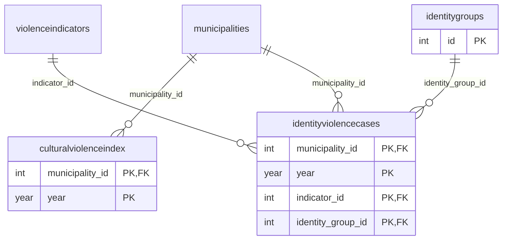
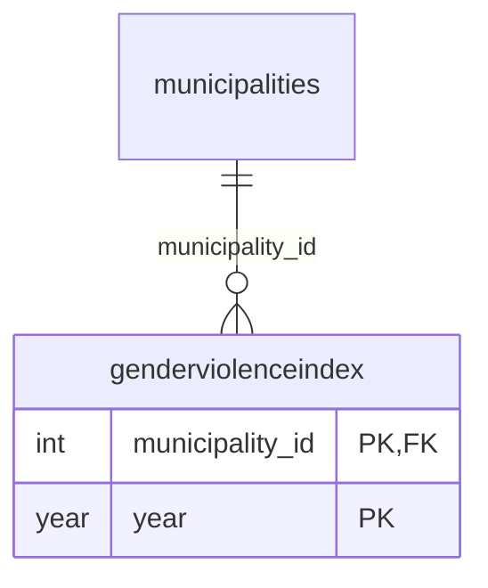
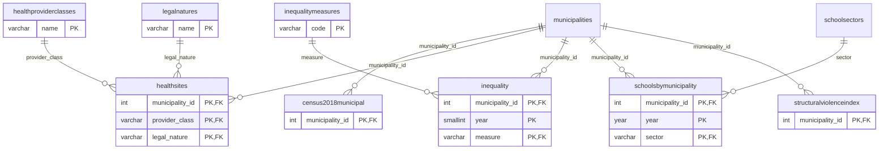
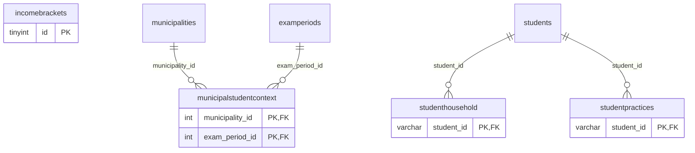
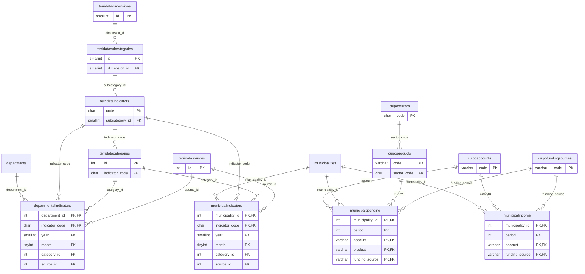
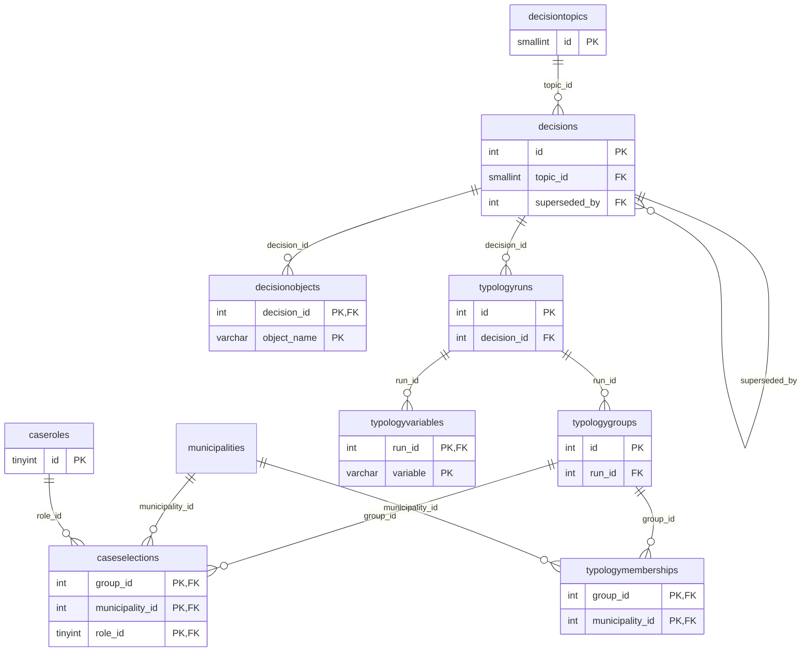

# Data model diagram

Generated by `python -m panel.diagram` from the database: each table with its primary (PK) and foreign (FK)
keys, and every foreign key as a relation. Tables of another area appear where they are referenced.

## RelationsAndConclusions

21 tables.

```mermaid
erDiagram
    constantterritories {
        int id PK
    }
    constantterritorymembers {
        int territory_id PK, FK
        int municipality_id PK, FK
    }
    dataqualityflags {
        int id PK
        varchar source FK
        int municipality_id FK
    }
    departments {
        int id PK
    }
    finalviolenceindex {
        int municipality_id PK, FK
        year year PK
    }
    government_phases {
        int id PK
        int government_id FK
    }
    governments {
        int id PK
    }
    measures {
        varchar code PK
        varchar source_code FK
        char modality_code FK
        int indicator_id FK
    }
    municipalities {
        int id PK
        int department_id FK
    }
    municipallineage {
        int daughter_id PK, FK
        int mother_id PK, FK
    }
    periodrates {
        int municipality_id PK, FK
        enum period_kind PK, FK
        varchar period_code PK, FK
        varchar measure PK, FK
    }
    periods {
        enum kind PK
        varchar code PK
        int government_id FK
        int phase_id FK
    }
    policedailycases {
        int municipality_id PK, FK
        date day PK
        int indicator_id PK, FK
        char sex_id PK, FK
    }
    population {
        int municipality_id PK, FK
        year year PK
    }
    populationbysexage {
        int municipality_id PK, FK
        year year PK
        char sex_id PK, FK
        tinyint age_from PK
    }
    sexes {
        char id PK
    }
    smoothedvalues {
        varchar source_table PK
        varchar column_name PK
        int municipality_id PK, FK
        varchar period PK
    }
    sourcedatasets {
        int id PK
        int source_id FK
    }
    sources {
        int id PK
    }
    violencecases {
        int municipality_id PK, FK
        year year PK
        int indicator_id PK, FK
        char sex_id PK, FK
        int dataset_id PK, FK
    }
    violenceindicators {
        int id PK
    }
    constantterritories ||--o{ constantterritorymembers : territory_id
    municipalities ||--o{ constantterritorymembers : municipality_id
    municipalities ||--o{ dataqualityflags : municipality_id
    sources ||--o{ dataqualityflags : source
    municipalities ||--o{ finalviolenceindex : municipality_id
    governments ||--o{ government_phases : government_id
    sources ||--o{ measures : source_code
    eventmodalities {
    }
    eventmodalities ||--o{ measures : modality_code
    violenceindicators ||--o{ measures : indicator_id
    departments ||--o{ municipalities : department_id
    municipalities ||--o{ municipallineage : daughter_id
    municipalities ||--o{ municipallineage : mother_id
    municipalities ||--o{ periodrates : municipality_id
    measures ||--o{ periodrates : measure
    periods ||--o{ periodrates : period_kind
    periods ||--o{ periodrates : period_code
    governments ||--o{ periods : government_id
    government_phases ||--o{ periods : phase_id
    municipalities ||--o{ policedailycases : municipality_id
    violenceindicators ||--o{ policedailycases : indicator_id
    sexes ||--o{ policedailycases : sex_id
    municipalities ||--o{ population : municipality_id
    municipalities ||--o{ populationbysexage : municipality_id
    sexes ||--o{ populationbysexage : sex_id
    municipalities ||--o{ smoothedvalues : municipality_id
    sources ||--o{ sourcedatasets : source_id
    municipalities ||--o{ violencecases : municipality_id
    violenceindicators ||--o{ violencecases : indicator_id
    sexes ||--o{ violencecases : sex_id
    sourcedatasets ||--o{ violencecases : dataset_id
```

## Physical_violence

9 tables.

```mermaid
erDiagram
    actforms {
        int id PK
        tinyint act_id FK
    }
    eventlinks {
        int event_a_id PK, FK
        int event_b_id PK, FK
    }
    eventmodalities {
        char code PK
    }
    eventsimultaneousacts {
        int event_id PK, FK
        tinyint act_id PK, FK
        int form_id FK
    }
    perpetratorgroups {
        int id PK
        int perpetrator_id FK
    }
    perpetrators {
        int id PK
    }
    physicalviolenceindex {
        int municipality_id PK, FK
        year year PK
    }
    simultaneousacts {
        tinyint id PK
    }
    violenceevents {
        int id PK
        int dataset_id FK
        char modality_code FK
        int municipality_id FK
        int perpetrator_id FK
        int perpetrator_group_id FK
    }
    simultaneousacts ||--o{ actforms : act_id
    violenceevents ||--o{ eventlinks : event_a_id
    violenceevents ||--o{ eventlinks : event_b_id
    violenceevents ||--o{ eventsimultaneousacts : event_id
    simultaneousacts ||--o{ eventsimultaneousacts : act_id
    actforms ||--o{ eventsimultaneousacts : form_id
    perpetrators ||--o{ perpetratorgroups : perpetrator_id
    municipalities {
    }
    municipalities ||--o{ physicalviolenceindex : municipality_id
    sourcedatasets {
    }
    sourcedatasets ||--o{ violenceevents : dataset_id
    eventmodalities ||--o{ violenceevents : modality_code
    municipalities ||--o{ violenceevents : municipality_id
    perpetrators ||--o{ violenceevents : perpetrator_id
    perpetratorgroups ||--o{ violenceevents : perpetrator_group_id
```

## Cultural_violence

3 tables.

## GENDER_VIOLENCE

1 tables.

## Structural_Violence

8 tables.

## Education_Outcomes

19 tables.

```mermaid
erDiagram
    certifiedentities {
        int id PK
        int department_id FK
        int municipality_id FK
    }
    educationauthority {
        int municipality_id PK, FK
        smallint year PK
        int entity_id FK
    }
    enrolmentanddropout {
        int municipality_id PK, FK
        year year PK
    }
    examperiods {
        int id PK
        int government_id FK
    }
    generacione {
        int municipality_id PK, FK
        date cutoff PK
    }
    higheredenrolment {
        int municipality_id PK, FK
        year year PK
        tinyint semester PK
        tinyint sector_id PK, FK
        tinyint level_id PK, FK
    }
    higheredlevels {
        tinyint id PK
    }
    higheredsectors {
        tinyint id PK
    }
    icetexcredits {
        int department_id PK, FK
        year year PK
        char sex PK, FK
        varchar level PK, FK
        enum kind PK
    }
    icetexlevels {
        varchar name PK
    }
    municipalscores {
        int municipality_id PK, FK
        int exam_period_id PK, FK
        char sex_id PK, FK
    }
    municipalscoresmicro {
        int municipality_id PK, FK
        int exam_period_id PK, FK
    }
    saberprobymunicipality {
        int municipality_id PK, FK
        int periodo PK, FK
        char sex_id PK, FK
    }
    saberproperiods {
        int id PK
    }
    schoolareas {
        varchar code PK
    }
    schools {
        bigint id PK
        int municipality_id FK
        varchar sector FK
        varchar area FK
    }
    schoolsectors {
        varchar code PK
    }
    students {
        varchar id PK
        int exam_period_id FK
        bigint school_id FK
        int municipality_id FK
        char sex_id FK
    }
    studentscores {
        varchar student_id PK, FK
    }
    departments {
    }
    departments ||--o{ certifiedentities : department_id
    municipalities {
    }
    municipalities ||--o{ certifiedentities : municipality_id
    municipalities ||--o{ educationauthority : municipality_id
    certifiedentities ||--o{ educationauthority : entity_id
    municipalities ||--o{ enrolmentanddropout : municipality_id
    governments {
    }
    governments ||--o{ examperiods : government_id
    municipalities ||--o{ generacione : municipality_id
    municipalities ||--o{ higheredenrolment : municipality_id
    higheredsectors ||--o{ higheredenrolment : sector_id
    higheredlevels ||--o{ higheredenrolment : level_id
    departments ||--o{ icetexcredits : department_id
    sexes {
    }
    sexes ||--o{ icetexcredits : sex
    icetexlevels ||--o{ icetexcredits : level
    municipalities ||--o{ municipalscores : municipality_id
    examperiods ||--o{ municipalscores : exam_period_id
    sexes ||--o{ municipalscores : sex_id
    municipalities ||--o{ municipalscoresmicro : municipality_id
    examperiods ||--o{ municipalscoresmicro : exam_period_id
    municipalities ||--o{ saberprobymunicipality : municipality_id
    sexes ||--o{ saberprobymunicipality : sex_id
    saberproperiods ||--o{ saberprobymunicipality : periodo
    municipalities ||--o{ schools : municipality_id
    schoolsectors ||--o{ schools : sector
    schoolareas ||--o{ schools : area
    examperiods ||--o{ students : exam_period_id
    municipalities ||--o{ students : municipality_id
    sexes ||--o{ students : sex_id
    schools ||--o{ students : school_id
    students ||--o{ studentscores : student_id
```

## Student_Context

4 tables.

## Territorial_Context

13 tables.

## State_Action

31 tables.

```mermaid
erDiagram
    coders {
        smallint id PK
    }
    entityfunctionassignments {
        int entity_id PK, FK
        smallint function_id PK, FK
        date valid_from PK
    }
    entityfunctions {
        smallint id PK
    }
    entityjurisdictions {
        int entity_id PK, FK
        int municipality_id PK, FK
        date valid_from PK
    }
    entitykinds {
        smallint id PK
    }
    entitysuccessions {
        int predecessor_id PK, FK
        int successor_id PK, FK
    }
    excerptentityevents {
        int excerpt_id PK, FK
        int entity_id PK, FK
        enum event PK
        smallint coder_id PK, FK
    }
    excerptobjectives {
        int excerpt_id PK, FK
        int objective_id PK, FK
        smallint coder_id PK, FK
    }
    excerptproblems {
        int excerpt_id PK, FK
        int problem_id PK, FK
        smallint coder_id PK, FK
    }
    excerptresources {
        int excerpt_id PK, FK
        int resource_id PK, FK
        smallint coder_id PK, FK
    }
    excerptresponsibilities {
        int excerpt_id PK, FK
        int responsibility_id PK, FK
        smallint coder_id PK, FK
    }
    governmentlevels {
        tinyint id PK
    }
    normamendments {
        int provision_id PK, FK
        int amended_by_id PK, FK
    }
    normexcerpts {
        int id PK
        int provision_id FK
    }
    normissuers {
        int norm_id PK, FK
        int entity_id PK, FK
    }
    normprovisions {
        int id PK
        int norm_id FK
        int parent_id FK
    }
    norms {
        int id PK
        smallint type_id FK
        int government_id FK
    }
    normtypes {
        smallint id PK
    }
    objectiveproblems {
        int objective_id PK, FK
        int problem_id PK, FK
        smallint coder_id PK, FK
    }
    objectiveresources {
        int objective_id PK, FK
        int resource_id PK, FK
        smallint coder_id PK, FK
    }
    objectives {
        int id PK
        smallint type_id FK
    }
    objectivetypes {
        smallint id PK
    }
    problemframers {
        int problem_id PK, FK
        int entity_id PK, FK
        smallint coder_id PK, FK
    }
    problemgroups {
        int problem_id PK, FK
        smallint group_id PK, FK
        smallint coder_id PK, FK
    }
    problems {
        int id PK
    }
    resources {
        int id PK
        smallint type_id FK
        int from_entity_id FK
        int to_entity_id FK
    }
    resourcetypes {
        smallint id PK
    }
    responsibilities {
        int id PK
        int entity_id FK
    }
    responsibilityobjectives {
        int responsibility_id PK, FK
        int objective_id PK, FK
        smallint coder_id PK, FK
    }
    socialgroups {
        smallint id PK
    }
    stateentities {
        int id PK
        smallint kind_id FK
        tinyint level_id FK
    }
    stateentities ||--o{ entityfunctionassignments : entity_id
    entityfunctions ||--o{ entityfunctionassignments : function_id
    stateentities ||--o{ entityjurisdictions : entity_id
    municipalities {
    }
    municipalities ||--o{ entityjurisdictions : municipality_id
    stateentities ||--o{ entitysuccessions : predecessor_id
    stateentities ||--o{ entitysuccessions : successor_id
    normexcerpts ||--o{ excerptentityevents : excerpt_id
    stateentities ||--o{ excerptentityevents : entity_id
    coders ||--o{ excerptentityevents : coder_id
    normexcerpts ||--o{ excerptobjectives : excerpt_id
    objectives ||--o{ excerptobjectives : objective_id
    coders ||--o{ excerptobjectives : coder_id
    normexcerpts ||--o{ excerptproblems : excerpt_id
    problems ||--o{ excerptproblems : problem_id
    coders ||--o{ excerptproblems : coder_id
    normexcerpts ||--o{ excerptresources : excerpt_id
    resources ||--o{ excerptresources : resource_id
    coders ||--o{ excerptresources : coder_id
    normexcerpts ||--o{ excerptresponsibilities : excerpt_id
    responsibilities ||--o{ excerptresponsibilities : responsibility_id
    coders ||--o{ excerptresponsibilities : coder_id
    normprovisions ||--o{ normamendments : provision_id
    normprovisions ||--o{ normamendments : amended_by_id
    normprovisions ||--o{ normexcerpts : provision_id
    norms ||--o{ normissuers : norm_id
    stateentities ||--o{ normissuers : entity_id
    norms ||--o{ normprovisions : norm_id
    normprovisions ||--o{ normprovisions : parent_id
    normtypes ||--o{ norms : type_id
    governments {
    }
    governments ||--o{ norms : government_id
    objectives ||--o{ objectiveproblems : objective_id
    problems ||--o{ objectiveproblems : problem_id
    coders ||--o{ objectiveproblems : coder_id
    objectives ||--o{ objectiveresources : objective_id
    resources ||--o{ objectiveresources : resource_id
    coders ||--o{ objectiveresources : coder_id
    objectivetypes ||--o{ objectives : type_id
    problems ||--o{ problemframers : problem_id
    stateentities ||--o{ problemframers : entity_id
    coders ||--o{ problemframers : coder_id
    problems ||--o{ problemgroups : problem_id
    socialgroups ||--o{ problemgroups : group_id
    coders ||--o{ problemgroups : coder_id
    resourcetypes ||--o{ resources : type_id
    stateentities ||--o{ resources : from_entity_id
    stateentities ||--o{ resources : to_entity_id
    stateentities ||--o{ responsibilities : entity_id
    responsibilities ||--o{ responsibilityobjectives : responsibility_id
    objectives ||--o{ responsibilityobjectives : objective_id
    coders ||--o{ responsibilityobjectives : coder_id
    entitykinds ||--o{ stateentities : kind_id
    governmentlevels ||--o{ stateentities : level_id
```

## Research_Design

9 tables.

